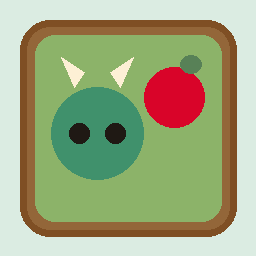

# Mochi Snake 3D Garden 🐉🍵

A cozy, relaxing 3D diorama snake simulation inspired by Studio Ghibli and Animal Crossing aesthetics. Watch a cute mochi dragon explore a miniature Japanese garden planter, gathering apples while winding gracefully through matcha stepping stones.



## ✨ Features
- **Cozy Diorama Aesthetic**: Miniature cedar wood planter box, rich soil bed, and checkerboard matcha garden tiles under soft morning light.
- **Cute Anime Dragon**: Smooth Catmull-Rom tube body, backward-sloping spine spikes that taper toward the tail, horns, whiskers, bead eyes, and blushing cheeks.
- **Spherical Apple**: Red delicious apple model with a wooden stem, vibrant leaf, and gentle floating bob.
- **Interactive Turntable**: Automatic slow cinematic camera rotation with drag controls and a pause toggle.
- **Smart Pathfinding**: Autonomous heuristic pathfinder ensuring long, satisfying runs.
- **PWA Ready**: Offline support with standalone manifest and compact 1:1 social sharing previews.
- **Modular Code**: Lightweight ES modules strictly adhering to the 200-line rule.

## 🚀 Quick Start

```bash
# Clone the repository
git clone https://github.com/SamSeenX/Snake3D.git
cd Snake3D

# Install dependencies
npm install

# Start local development server
npm run dev

# Build for production
npm run build
```

## 🛠️ Architecture
- **Rendering**: Vanilla Three.js
- **Build System**: Vite targeting ES2022
- **Styling**: Modern Vanilla CSS and Fredoka typography
- **State**: Reactive pub-sub store and event bus

## 📄 License
MIT License. Created by SamSeen.
